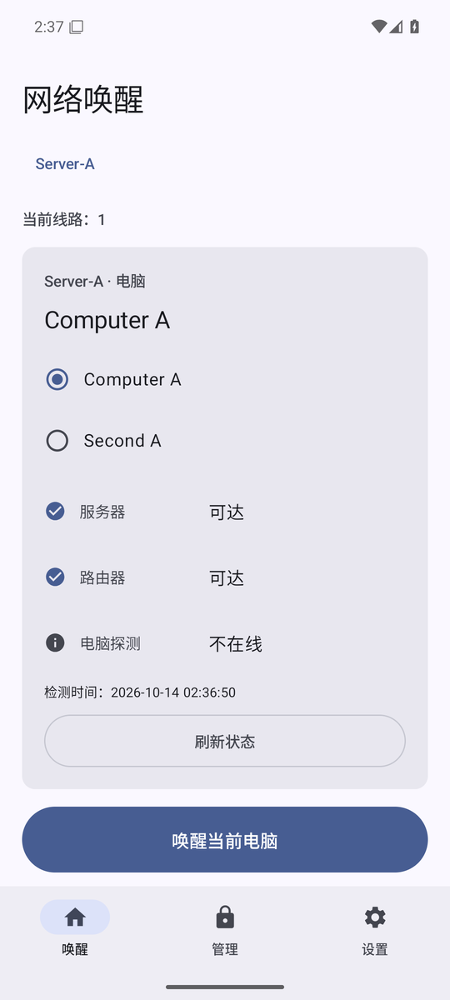
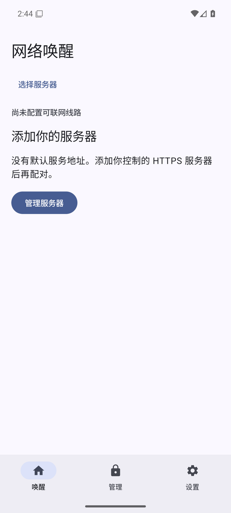
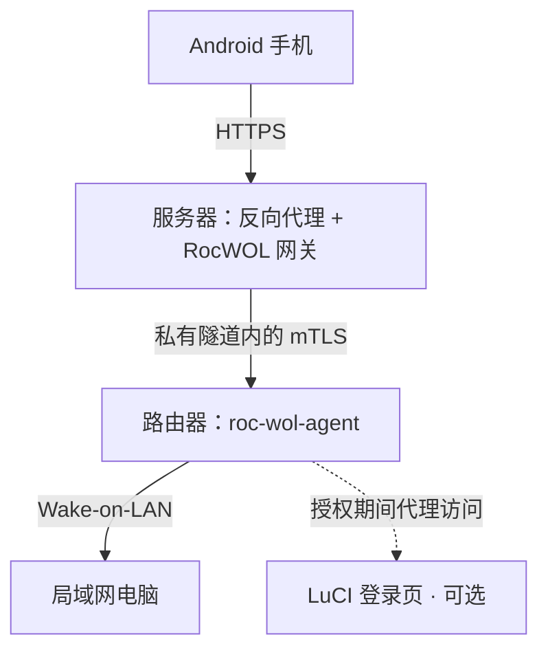

# RocWOL

身处在外也能唤醒家中电脑

你在手机上点一下，请求先到服务器，服务器顺着私有隧道找到你家的路由器，由路由器在局域网里发送一个 Wake-on-LAN 魔术包。整套东西自己部署，没有官方服务器，也不用注册账号。家里和办公室可以加进同一个 App，各自配对、各自授权，互不影响。

[版本与安装包](https://github.com/Arrebolveil/RocWOL/releases) · [开始使用](#开始使用) · [部署选项](#部署选项) · [从源码构建](#从源码构建) · [GPLv3](LICENSE)

<p align="center">
  
  &nbsp;
  
</p>

<p align="center"><sub>图是 Android 16 模拟器上截的，跑在隔离测试环境里；里面的服务器名和电脑名都是示例。</sub></p>

## 能做什么

- 一个网关管一个局域网。家里一个、办公室一个，分开部署，在 App 里切换。每个服务器下最多挂 64 台电脑，MAC、IP、网卡接口这些写在部署清单里，手机上就只剩选一台、点一下。
- 唤醒没回音的时候，能翻出上一次请求走到哪了。App 不会自己重发，也不会挑另一条线路悄悄补发一次，要不要重试由你决定。
- 路由器管理默认关着。你不填 `luciOrigin`，App 就显示“此服务器未启用路由器管理”；填了以后，每次新授权都要过一次系统锁屏认证，可以授权 5、10、15、30 分钟或者永久，随时能手动结束。
- 日志、唤醒历史、连接诊断都存在手机上，出问题时有地方翻。长期管理授权可以设提醒，免得忘了它还在生效。

界面用 Jetpack Compose 和 Material Design 3 写的，跟随系统深浅色。App 里不带任何服务器地址，也没有公共云账号。

> “已发送”只是说路由器把魔术包丢出去了，不等于电脑已经开机。先确认 BIOS、网卡和电源这些设置确实支持 WOL，再去查远程链路，能少绕不少弯。

## 开始使用

### 1. 先凑齐这几样东西

- **手机**：Android 11 或更新版本，设了锁屏密码，能完成逐次系统身份验证。
- **服务器**：一台 amd64 或 arm64 的 Linux 主机。自动部署靠 systemd，所以得能拿到 root 的 SSH 权限。
- **路由器**：OpenWrt 或 ImmortalWrt，能运行 `etherwake` 和 `ping`，并且和目标电脑在同一个局域网里。
- **HTTPS 入口和转发**：一个手机信得过的 HTTPS 地址，外加服务器到路由器的私有转发。手上已经有 FRP 就直接复用，没有就自己准备一条隧道。

电脑能不能从睡眠或者关机状态被叫醒，取决于主板和电源设置。这件事 RocWOL 帮不上忙，得你自己去 BIOS 里确认。

### 2. 部署网关和路由器执行端

网关、agent 和 `build-manifest.json` 必须是同一个版本，一起放进 `dist/`。安装包在 [Releases](https://github.com/Arrebolveil/RocWOL/releases)；仓库现在还是私有的话，你得先拿到访问权限。想自己编译，见[从源码构建](#从源码构建)。

在项目根目录执行：

```sh
npm ci --prefix tools
node tools/deploy.mjs init --config private/home.json
```

生成出来的 `private/home.json` 是个空模板。打开它，把两端的 SSH 地址、主机指纹、凭据文件、HTTPS 地址和目标电脑都填好。`deploymentId` 已经生成好了，留着别动。

`targets` 里的一台电脑长这样：

```json
{
  "id": "desk-pc",
  "name": "书房电脑",
  "mac": "02:00:00:00:00:01",
  "interface": "br-lan",
  "broadcast": true,
  "ip": "192.0.2.10"
}
```

MAC 和 IP 是随手写的，记得换成真的。`interface` 填的是路由器上发包的那块接口，不是电脑的网卡名。

初始模板配的是 `external` 隧道加 `manual` 代理，这两样得你自己准备。想让脚本顺手把专用 FRP 客户端配好，或者代配 nginx 和 1Panel，就按[部署选项](#部署选项)改对应的字段。

填完按顺序跑这三条：

```sh
node tools/deploy.mjs inspect --config private/home.json
node tools/deploy.mjs stage --config private/home.json
node tools/deploy.mjs verify --config private/home.json
```

`inspect` 只看不动，`stage` 才真的往远端装东西，所以 `inspect` 没过就别往下走。`verify` 会临时配对一台测试设备、把协议跑一遍再撤销，不发唤醒包，但它要占掉一个配对名额，记得留空。用手动代理的话，先把脚本生成的代理片段装上，再继续查 HTTPS。

主机指纹请从可信渠道核对，别看到提示就直接回车。凭据那几个字段只填文件路径，密码、私钥、FRP token 都不要写进清单、命令行和提交记录。

### 3. 在手机上添加服务器并配对

1. 装好 App，进“管理服务器”，填个名字和 HTTPS 地址，比如 `https://wol.example`。只填地址和端口，别带路径。
2. 点“验证并保存”。证书或者服务版本有问题，就先去把服务器修好，App 里没有“忽略证书错误”这种按钮。
3. 到服务器上生成一个一次性配对码：

   ```sh
   /opt/roc-wol/bin/roc-wol pair-code --socket /run/roc-wol/admin.sock --ttl 10m
   ```

4. 把配对码填进 App，过一遍系统认证，选好要唤醒的电脑。

到这里就能刷新状态、唤醒、查上一次请求了。要接第二处网络，就新建一个服务器档案，别把它填成当前服务器的备用线路。

## 连接方式



一套网关只服务一个局域网，多处网络分开部署，再从 App 里切换。路由器上的 LuCI 不用暴露到公网；就算开了管理代理，访问它照样要过它自己的登录。

## 部署选项

隧道、反向代理、证书这三样各选各的，不要求来自同一个平台。

|配置项|选项|怎么选|
|---|---|---|
|`transport.mode`|`frp` / `external`|手上已经有带 token 认证的 frps，就用 `frp`，脚本会给这个项目单独装一个客户端；其他隧道一律填 `external`|
|`proxy.mode`|`nginx` / `onepanel` / `manual`|愿意让脚本去改现有的 nginx / OpenResty，就选前两个；不想让它碰你的配置，选 `manual`，自己把生成的片段装进去|
|`tls.mode`|`external` / `acme-http01`|证书已经有了，就引用原文件；想让它自动签发，用主机上装的 Certbot|

<details>
<summary>清单里还有哪些字段</summary>

- `server` / `router`：主机、SSH 端口、root 用户、`hostKeySHA256`，以及 `auth.privateKeyFile` 或 `auth.passwordFile`，二选一。指纹是 **64 位小写十六进制**，不是带 `SHA256:` 前缀的 Base64 字符串。
- `publicOrigins`：手机访问的 HTTPS 地址，可以写多条。非默认端口要写进地址里。
- `targets`：电脑清单，最多 64 台。每台的 `id` 唯一，以小写字母或数字开头，中间可以有数字、下划线和连字符，最长 64 个字符。
- `pingPath` / `etherwakePath`：路由器上这两个程序的绝对路径，部署前先确认它们真的存在。
- `luciOrigin`：留空就是关掉路由器管理。要启用就填路由器本机地址，比如 `http://127.0.0.1:80`。
- `maxDevices`：最多允许配对多少部手机，默认 5，可以设 1 到 100。把上限调低不会踢掉已经配对的手机。
- `gatewayPort` / `visitorPort` / `agentPort`：默认分别是 18081 / 18082 / 19991。端口撞了脚本会停下来报错，不会自己换一个了事。

相对路径按清单所在的目录解析，远端路径要写绝对路径。Linux 上的凭据文件还得把读取权限收紧。完整的字段校验规则在 [`tools/deployment-config.mjs`](tools/deployment-config.mjs)。

</details>

<details>
<summary>FRP、证书和 1Panel 的注意事项</summary>

**FRP**

`frp` 模式需要填 `frpsHost`、`frpsPort`、`tokenFile`，以及路由器上现成的 `routerFrpcPath`。脚本加的是一个专用 STCP 配置和服务，不会动共享的 frps，也不会改 `/etc/config/frpc`。FRP 两端启用 TLS，除了登录，心跳和新连接也都要认证。带 OAuth 的 frps、需要自定义 TLS 根证书或客户端证书的 FRP 配置不在当前清单的支持范围内，这类环境请走 `external` 自己接。

**已有证书**

`external` 模式填服务器上 `fullchainFile` 和 `privateKeyFile` 的路径。项目只是引用这两个文件，不复制证书，也不接管原来那份自动续期的任务。用 IP 地址访问的话，证书里得有匹配的 IP SAN。

**自动签发**

`acme-http01` 需要域名、邮箱、主机上已经装好的 Certbot，以及公网能访问的 80 / 443 端口。填 `webrootHost` 和 `tlsDirHost`；脚本先走一遍测试签发，通过了再申请 Let's Encrypt 正式证书。测试环境的证书不能拿来给普通手机用。

**nginx / 1Panel**

自动模式要求 `configDir` 已经被代理加载。1Panel 还要填 OpenResty 容器名，以及宿主机到容器的证书目录映射 `tlsDirHost` / `tlsDirContainer`；ACME 模式另需 `webrootContainer`。脚本会去核对真实挂载，只填一个看着像的路径是过不了的。

</details>

<details>
<summary>重复部署、旧配置和手动安装</summary>

自动安装每台主机只支持一个 RocWOL 实例，占用 `/opt/roc-wol`、`/etc/roc-wol` 和 `/var/lib/roc-wol`。文件归属和摘要记在 `/etc/roc-wol/deployment-owner.json` 里；碰到别人的文件，或者被外部改动过的配置，脚本会拒绝覆盖。

改完目标电脑、域名或者端口，重新跑一遍 `inspect` 再 `stage`。已经部署的隧道、代理、证书不支持直接切 mode；要换就得先由管理员按归属清单把旧项目的资源停掉，免得留下甩不掉的旧隧道和续期任务。

旧 schema1 清单可以生成一份待检查的 v2 草稿，原文件不会被改动：

```sh
node tools/deploy.mjs migrate-config --config private/old-deployment.json
```

不满足自动安装条件的话，手动装 Go 二进制也行。服务模板在 [`deploy/server`](deploy/server) 和 [`deploy/router`](deploy/router)，运行时字段分别见 [`gateway.Config`](internal/gateway/config.go) 和 [`agent.Config`](internal/agent/config.go)。网关和 agent 都该监听回环地址，私有转发里同样需要 mTLS。

</details>

## 路由器管理和设备撤销

路由器管理默认是关的，填上 `luciOrigin` 才启用。手机用一个独立的管理密钥逐次完成系统认证，可以授权 5、10、15、30 分钟或者永久；永久授权记得手动结束，网关重启也会一并清掉。

“允许所有设备访问”这个开关要留神：打开之后，凡是能访问到你这个域名的人都能进 LuCI 登录页，**不只是当前这部手机**。不需要就别开。切换服务器不会结束上一台服务器的授权，两个地方的管理提醒也是各算各的。

手机丢了，就在服务器上把它撤掉：

```sh
/opt/roc-wol/bin/roc-wol devices list --socket /run/roc-wol/admin.sock
/opt/roc-wol/bin/roc-wol devices revoke --socket /run/roc-wol/admin.sock --id <设备ID>
```

App 里那个“配对设备”是另一回事，得管理员单独授予，新配对的手机默认没有：

```sh
/opt/roc-wol/bin/roc-wol devices admin --socket /run/roc-wol/admin.sock --id <设备ID> --enabled=true
```

只在手机上清除身份，或者删掉服务器档案，服务器那边不会跟着撤销。设备离线之后才移除的，如果不放心授权是不是还生效，回服务器上再撤一遍。

## 常见问题

### 显示“不在线”，但电脑明明开着

状态是 ICMP 探出来的，被电脑的防火墙或者网络规则一挡就探不到。“不在线”不等于确定关机，“未知”也不是发包失败。去路由器上 `ping` 同一个 IP 看看，很快能分辨。

### 超时了，要不要再点一次唤醒

先查原请求。网关和 agent 按请求 ID 去重，你手动再点一次就是一个新请求了。App 不会自动重发，也不会为了报个成功而换线路。

### 备用线路和另一台服务器有什么区别

备用线路是同一个服务实例的另一个 HTTPS 地址，添加的时候会核对实例标识。另一处网络得新建服务器档案、重新配对。在 App 里手动切线时，会先经新线路确认结束当前设备的旧管理授权，确认不了就保留原来的选择。

### 证书为什么不受信任

按顺序查这几样：域名是否匹配、证书是否过期、完整证书链是否发全、签发 CA 手机是否信任。自签证书和 Let's Encrypt 测试证书都替代不了正式的公网证书。换 EC 算法、清缓存这些做法，修不了信任链。

### 从旧版升级会丢配对吗

2.0 沿用旧的身份和密钥，只恢复手机实际保存过的地址，没保存过的要手动补填。App、网关和 agent 要一起升到 v2，旧接口会返回 `426 protocol_upgrade_required`。升级前先备份两端数据库；迁移出错也别删库重来。

### 日志会保存我的地址和密钥吗

日志只存在手机本机，合计最多 7 天、2000 条。令牌、密钥、配对码和完整响应都不写进去，导出的时候服务器和电脑会换成编号。清空日志不影响配对和服务器授权，但已经分享出去的副本得你自己处理。

## 从源码构建

Android 这边需要 JDK 17 和 Android SDK 36，用仓库自带的 Gradle Wrapper。Go 用 1.26.3，部署工具需要 Node.js 24 或更新。

Windows 下构建开发版 APK：

```powershell
android\gradlew.bat -p android :app:assembleDebug
```

Linux 下单独构建两个 Go 服务：

```sh
go build -o roc-wol ./cmd/roc-wol
go build -o roc-wol-agent ./cmd/roc-wol-agent
```

跑现有的测试：

```sh
npm ci --prefix tools
go test ./...
node --test tools/deployment-config.test.mjs
```

```powershell
android\gradlew.bat -p android :app:testDebugUnitTest
```

Linux 上还能跑 `go test -race ./internal/...`。Android instrumentation 测试请用干净的专用模拟器，迁移用例会往旧版数据里写东西。

<details>
<summary>正式打包和签名</summary>

Windows 上的打包入口：

```powershell
powershell.exe -NoProfile -ExecutionPolicy Bypass -File tools/build.ps1
```

脚本会自己准备一套独立工具链，产出 `dist/roc-wol-release.apk`、APK 校验文件、网关和 agent 的 linux-amd64 / linux-arm64 二进制，以及 `build-manifest.json`。APK 不读部署清单。

这条脚本是给官方包用的，要求签名文件已经存在，缺了不会给你新建身份。默认目录是 `%LOCALAPPDATA%\RocWol\signing`，也可以用 `ROCWOL_KEYSTORE`、`ROCWOL_STORE_PASSWORD_FILE`、`ROCWOL_KEY_PASSWORD_FILE` 指向外部文件。只有签名匹配下面这个证书，脚本才会覆盖 dist 里已有的 APK：

```text
25182452bd65c3311cf5f4508b98bdfdd3636e8ca631d2b55cc7dee131fadad5
```

自己签名可以直接用 Gradle 的 `rocwol.keystore`、`rocwol.storePasswordFile`、`rocwol.keyPasswordFile` 属性。签名不一样，就覆盖不了已经装上的官方包。`rocwol.releasesUrl` 用来指向你自己的 HTTPS 发布入口，留空就把入口藏起来，默认指向本仓库的 Releases。

</details>

## 验证情况

我自己真正跑过的：Go 全量测试和 Linux 上的 race 测试，Android 单元测试和模拟器迁移测试，部署配置测试。另外拿两台测试服务器做过实际配对、身份隔离和独立提醒，接的是真实 nginx 和 FRP 回环连接。WOL 在隔离网络里用真实 etherwake 抓包验证过，没有往真实电脑发过包。

还没跑过的：OpenWrt / procd 自动安装，1Panel 的证书映射与续期，双主机安装和恢复，完整远端 `verify`，真实域名 ACME 签发，以及物理手机和物理电脑。旧提醒任务的首次启动、迁移中断后的恢复，也没有逐阶段测全。模拟器和回环的结论，不能当成这些场景已经验收。

## 反馈与贡献

有问题开 [Issues](https://github.com/Arrebolveil/RocWOL/issues)。写清楚 App / 网关 / agent 的版本、路由器型号和系统版本，再加上操作前后的现象，能省不少来回。脱敏日志可以一起贴；配对码、token、私钥和真实部署清单不要上传。

`private/` 和 `dist/` 不入库。发布自己的分支之前，顺手翻一下提交历史，旧历史里可能还留着个人域名和部署记录。

## 许可证

Copyright © 2026 Adrian

RocWOL 按 [GNU General Public License v3.0](LICENSE)（`GPL-3.0-only`）分发，不提供担保，详见许可证。第三方组件保留各自的许可证。

本次变更不追溯撤回此前按 MIT 许可证分发的版本所授予的权利。
